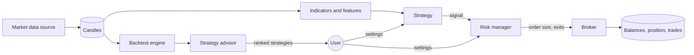

# Architecture

## Flow

The same strategy, risk manager and broker are used in two ways:

- The **backtest engine** replays history through them to measure a strategy.
- The **trader** runs them on each new candle to trade automatically.

The **advisor** runs a backtest for every candidate strategy and ranks the results for the user's risk profile.

## Rules the code keeps

1. **No look-ahead.** A strategy's signal on a candle may use only that candle and earlier ones. In a backtest the signal is read at the close and filled at the next open. A test checks that adding later candles never changes an earlier signal.
2. **Training data is kept apart.** A strategy that learns is trained on the first part of the history and measured only on the rest.
3. **Risk decides size, not the strategy.** A strategy says buy, sell or hold. The risk manager sets the quantity, the stop and the target, and can halt trading.
4. **Costs are always charged.** Every simulated fill pays a fee and slippage.
5. **Paper first.** Live orders are behind a separate broker that does not exist yet, and the command line refuses `mode: live`.
6. **Secrets stay out of files.** Exchange keys come from the environment.

## Components

| Component | File | Responsibility |
| --- | --- | --- |
| Settings | `config.py` | Validated user settings from YAML |
| Sources | `data/source.py` | `fetch(symbol, timeframe, limit)` returning closed candles, oldest first |
| Indicators | `features/indicators.py` | SMA, EMA, RSI, MACD, ATR, Bollinger bands |
| Features | `features/builder.py` | Scale-free feature table and labels for learning |
| Strategies | `strategies/` | `signals(candles)` returning buy, sell or hold per candle |
| Risk manager | `risk/manager.py` | Position size, stop and target prices, drawdown halt |
| Broker | `execution/broker.py` | One long position; simulated fills with fee and slippage |
| Backtest | `backtest/engine.py`, `metrics.py` | Replay and performance figures |
| Advisor | `recommend/advisor.py` | Ranks candidate strategies per risk profile |
| Trader | `bot/trader.py` | The live loop, with saved state |
| CLI | `cli.py` | `fetch`, `backtest`, `recommend`, `run` |

## Current limits

- Spot, long-only, one market, one position at a time.
- Market orders only; simulated fills assume the full quantity trades at one price.
- The ML model is trained once per backtest or bot start; it is not retrained as new data arrives.
- Stops are checked when a candle closes in the live loop, not tick by tick.
- No live broker, no web interface, no notifications.

## Adding a strategy

1. Create a class in `strategies/` that extends `Strategy` and implements `warmup` and `signals`. Set `requires_training = True` and implement `fit` if it learns.
2. Register it in `strategies/__init__.py`.
3. Add it to `CANDIDATES` in `recommend/advisor.py` if the advisor should consider it.
4. The existing tests then check it for valid output and look-ahead automatically.
